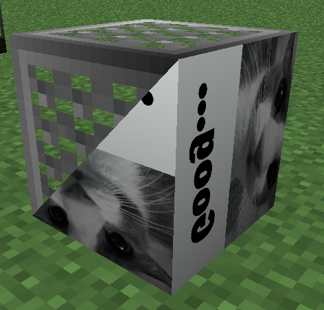

# ArchitectureCraft: Renovated

A 1.12.2 continuation of [TridentMC/ArchitectureCraft](https://github.com/TridentMC/ArchitectureCraft).
More features will follow.

Based on TridentMC branch `1.12` at `8f85b04` (release `1.12-3.108`).
This is not an official TridentMC release.

*Distinguished architectural features for your Minecraft buildings, restyled for Kyn's sensibilities.*



## Current additions

The shape IDs `94-116` are the same as GTNH's fork, so existing IDs `0-93`
are untouched; `117` is Renovated-specific:

| IDs | Shapes |
|---|---|
| 94-102 | Slope A/B/C start/middle/end pieces |
| 103-111 | The same slopes, self-emissive |
| 112 | Roof Tile, self-emissive |
| 113 | Square, self-emissive |
| 114 | Slab, self-emissive |
| 115 | Angled Roof Ridge |
| 116 | Double Roof Tile |
| 117 | Wall |
| 118 | Fence |
| 119-128 | Siding versions of Roof Tile and the nine slopes |
| 129 | Paneling |
| 130 | Double Siding |
| 131 | GregTech |
| 132-149 | Corner wedges: A/B/C families in 2, 3 and 4 bands, plus glow duplicates |

The shapes use the existing `architecturecraft:shape` block and `TileShape`.
They add no new block, tile entity or per-shape blockstate. The glow
shapes use the existing `LIGHT` blockstate at level 15; GTNH's separate
`shapeSE` block is not used.

The sawbench gets a new **Glow** page; the 23 GTNH shapes, the wall, the fence
and the GregTech plaque are on the existing **Other** page. The icon atlas is
split at ID 110, following GTNH:
IDs 0-109 use `shapemenu_items.png`, IDs 110+ use `shapemenu_items_1.png`.

### Wall

The wall is one shape that derives its arms from the world: it connects to
another wall shape and to any full cube, and re-renders when a neighbour
appears or disappears. A straight north-south or east-west run uses a slim
core; isolated walls, corners, T junctions and crossings use the full post.
The 16 horizontal connection masks therefore need no separate shape IDs, and
the `disabledConnections` bits of `TileShape` still apply for chisel control.
One material block makes two walls. The wall has no rotation (hammer use does
nothing) and does not accept cladding.

### Fence

The fence follows vanilla behaviour: a 4×16×4 post with two thin rails
towards every side that connects to another fence or to a full cube. It uses
the same connection rules as the wall (including `disabledConnections`), has
no rotation and no cladding. Collision is 1.5 blocks high, as in vanilla, so
the fence cannot be jumped over from flat ground; the selection box stays the
post. One material block makes four fences.

### Siding

The Siding page holds upright versions of Roof Tile and the nine slopes.
They use the same geometry, profiles and connections as the roofing shapes but
always place on their side: on a wall the visible face points out of the wall,
on the floor or ceiling the piece stands upright facing the player. The sloped
face uses the model's own UVs with the grain turned, so a wall piece does not
show its material sideways. Each entry has its own shape ID, so the roofing
shapes are unchanged.

Paneling is a 3 px vertical panel, flush with the block boundary, that mounts
on the face you click. Cladding can be applied to its room-facing side. One
material block makes four panels.

Double Siding is a full block split vertically down the middle: one half is
the base material, the other takes the cladding material. Without cladding the
whole block reads as the base material.

## Compatibility

- Minecraft 1.12.2, Forge 14.23.4.2747.
- Existing shape IDs `0-93` and existing worlds/structures are unchanged.
- A shape made with the new IDs in a world loaded by an older build will fall
  back to `ROOF_TILE` (the mod's unknown-ID fallback), not crash.
- The new **Glow** sawbench page is forward-compatible; an older build opening
  a save whose selected page is 7 may hit the old page-array bounds check.

## Build

The 1.12 branch uses Gradle 4.1, ForgeGradle 2.3 and a Java 8 JDK. The included
wrapper downloads Gradle 4.1.

```powershell
$env:JAVA_HOME = "<path-to-a-JDK-8>"
# Optional: keep the Gradle cache inside the checkout.
$env:GRADLE_USER_HOME = "$PWD\.gradle-home"
.\gradlew.bat build --console=plain
```

## Credits and licence

See [CREDITS.md](CREDITS.md) for the per-contributor asset and code credits.

- Original ArchitectureCraft: Greg Ewing (gcewing), MIT.
- 1.12 port: TridentMC / darkevilmac / unascribed contributors, MIT.
- Renovated fork: Neeyo (maintainer), MIT.
- GTNH shape additions: Sampsa (slopes), Superfrogman98 (angled ridge, double
  roof tile, glow icons), Imgood (glow category), MIT.
- Double Roof Tile geometry uses the GTNH model; its front/back faces are a
  diagonal base/cladding split, not duplicate quads.

The project is MIT. See [LICENSE](LICENSE) and [NOTICE](NOTICE) for the
upstream and GTNH notices.
